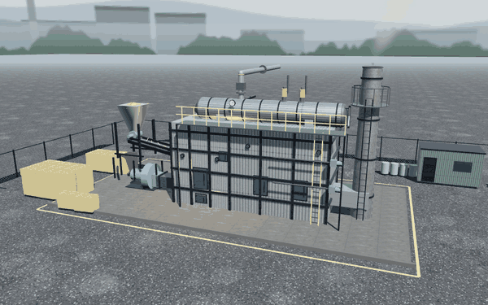
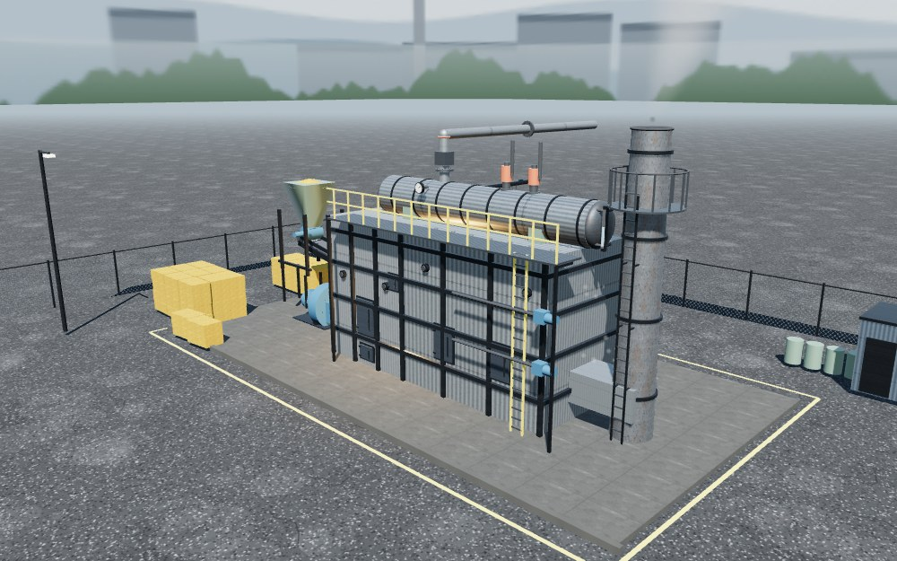
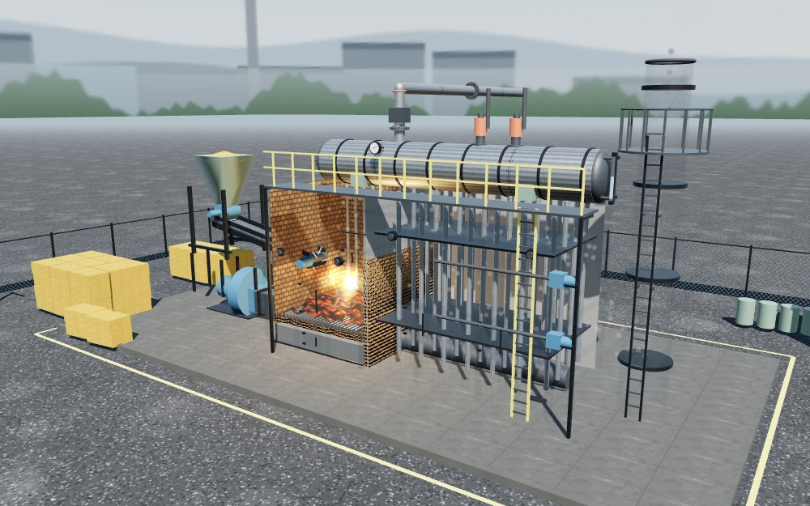

# Rice-Straw Boiler: 3D model

An interactive 3D model of a biomass (rice-straw) fired water-tube boiler. The outside view shows the insulated steel casing, buckstays, access doors, service platform and ladder, stack and fuel feed. The inside view removes the casing to show the refractory-lined furnace with a glowing fuel bed and flames, the water tube bank, steam drum and flow paths. It sits in a generated outdoor plant yard (fence, straw bale stacks, site cabin, lamp post, distant skyline and trees) and runs as a working simulation: sliders for fuel feed and combustion air change the flame, smoke colour, fan speed, conveyor flow, gas flow and the drum pressure gauge, a Fire on / Fire out button puts the fire out and relights it, and Add straw (or a click on the hopper) throws extra straw into the furnace so the fire flares up and then settles. Built with plain HTML and three.js, using procedural textures, physically based materials and shadows.

| Outside | Inside |
| --- | --- |
|  |  |

## Run it

Open `index.html` in a browser with an internet connection (it loads three.js r128 from cdnjs). Drag to rotate, scroll or pinch to zoom. Use the Fuel feed and Combustion air sliders and the Start/Stop button to run the boiler. Buttons switch between Outside and Inside, turn the flow overlay and part labels on or off, auto-rotate and pause. To show it as a web page, enable GitHub Pages for the repository.

## What is modelled

Straw hopper with rotary valve and belt conveyor, furnace with grate bars, fuel bed and flames, forced-draught fan and motor, boiler tube bank with support plates and soot blowers, steam drum with safety valves, level gauge and pressure gauge, lower header, flue gas path to the stack, feed water pump and line, and steam outlet with stop valve.

## Background

Based on my industry project at Thermax Limited, Pune (12/2024 to 04/2025) and the paper: A. Ramtekkar, S. Mallik, V. N. Raibhole, *Design and Simulation of Rice Straw Boiler*, IJARSCT, Vol. 5, Issue 14, April 2025. DOI: 10.48175/IJARSCT-26591. Modelled design point: 75 to 80 % thermal efficiency and about 30 % lower CO2 than coal-fired boilers.

## Real background

The sky and horizon are generated in code. To use a real photo or HDRI instead, save an equirectangular (360 degree panorama) image as `background.jpg` next to `index.html` and serve the folder (for example with GitHub Pages). The model then uses it for the background and for the lighting reflections. Free CC0 panoramas are available from Poly Haven.

## Limits

This is an illustration built from generic boiler construction, not an engineering drawing. Proportions and equipment are simplified and not to scale, and the flame, smoke and flow animation is for visual effect only. The slider effects are qualitative (flame size, smoke colour, relative steam output) and do not compute real boiler values.
